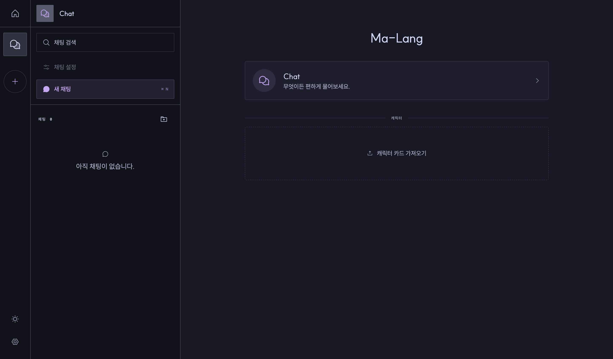

# Malang

A fully server-side, battery included, self-hosted character AI chat app.



## Installation

You need Docker and an API key (or local Ollama) for at least one model provider.

### Docker Compose

```sh
cp .env.example .env      # set SESSION_SECRET and ADMIN_PASSWORD
docker compose up -d --build
docker compose down       # stop (add -v to also delete the saved data)
```

Open <http://localhost:8080>, sign in with `ADMIN_PASSWORD`, then add a provider and model
preset in **Settings**.

## Features

- **Character cards**: import RisuAI cards with lorebooks, regex scripts, assets, and Lua triggers
- **Prompts**: RisuAI prompt presets and prompt modules, assembled the way PocketRisu does
- **Providers**: OpenAI-compatible APIs, Anthropic, Google AI Studio, Vertex AI, AWS Bedrock,
  Cohere, and Ollama
- **Model chains**: route a generation through several models with a node editor
- **Illustrations**: NovelAI image generation for scenes in a conversation
- **Personas**: user personas with their own names, avatars, and descriptions
- **Local storage**: SQLite database, assets, and automatic backups in one data volume

## Development

```sh
bun install
cp .env.example .env
bun run dev               # server on :3000, web on :5173
bun run check             # format, lint, and typecheck
bun run test
```

- [web/README.md](web/README.md): frontend layout and feature boundaries
- [AGENTS.md](AGENTS.md): code style, database migrations, and test conventions

## License

Malang is licensed under the [GNU General Public License v3.0](./LICENSE) (GPL-3.0-only), the
license of the RisuAI and PocketRisu code it contains. See [NOTICE](./NOTICE) for third-party
attribution.
